<div align="center">

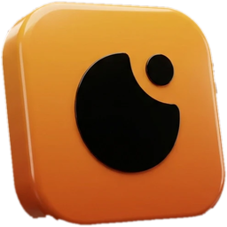

# Drive Well

### 주행 뒤, 공정하게

내비가 아는 다음 회전과 차가 아는 깜빡이·감속을 맞춰<br>
운전을 **상황까지 보고 평가하는** Pleos Connect 차량용 앱


[APK 내려받기](apk/DriveWell_release.apk) · [실행 방법](#실행-방법) · [화면](#화면) · [데이터와 SDK](#데이터와-sdk) · [테스트 환경](#테스트-환경과-필요-설정)

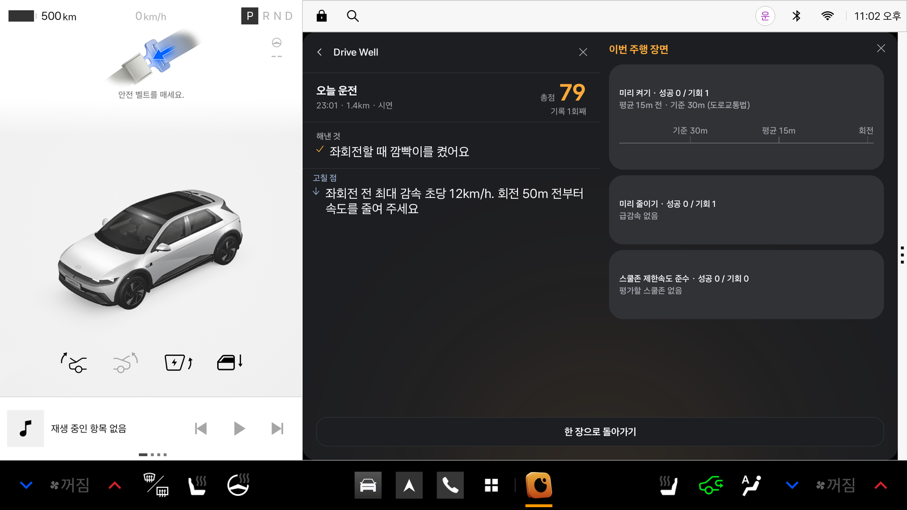

</div>

주차한 뒤 알림 하나를 누르면 방금 운전이 한 장으로 나온다. 해낸 것 하나와 고칠 점 하나가 문장으로 적혀 있고, 깜빡이를 회전 몇 m 전에 켰는지가 30m 기준 자 위에 보인다. 주행 중에는 화면도 소리도 없다.

## 왜 만들었나

지금의 안전운전 점수가 공개한 항목은 과속, 급가속, 급감속, 심야 운행이다. 그 행동이 어떤 상황에서 나왔는지 가르는 항목은 없다.

| 사실 | 수치 | 출처 |
|---|---|---|
| 교통사고 절반 가까이가 교차로에서 난다 | 48.4% (2025년, 사고 건수 기준) | 도로교통공단 교통사고 통계분석 |
| 좌회전할 때 깜빡이를 켜지 않는 차가 네 대 중 한 대다 | 방향지시등 점등률 75.7% (2025년) | 국토교통부 교통문화지수 실태조사 |
| 깜빡이 위반 신고가 많다 | 공익신고 453,161건 (2025년) | 보도 |

깜빡이와 회전 안내는 차만 함께 볼 수 있다. 폰 내비는 회전까지 남은 거리는 알아도 깜빡이는 읽지 못하고, 차는 깜빡이는 알아도 다음 회전을 모른다. Pleos Connect 앱은 이 둘을 같은 시각에 받는다.

## 핵심 기능

| 기능 | 하는 일 |
|---|---|
| **미리 켜기** | 깜빡이를 켠 순간 회전까지 남은 거리로 점수를 매긴다. 30m 전이면 만점이고(도로교통법 시행령 기준) 15m 전이면 절반이다 |
| **미리 줄이기** | 회전 앞 50m 구간의 감속으로 점수를 매긴다. 이 구간의 급감속은 급감속 횟수에서 빼서 두 번 깎지 않는다 |
| **점수의 이유** | 주차 직후 오늘의 한 장에 이유를 문장으로 보여 준다. 산정식과 상수는 앱 안 "점수 기준" 화면에 공개한다 |
| **운전 증명** | 최근 6개월·500km의 총점과 추이를 한 화면에 쌓는다 |

같은 방식으로 스쿨존 속도와 과속방지턱 앞 감속도 평가한다. 차량 경고등(ESC, ABS)이 켜진 시점 앞뒤 5초의 급감속은 점수에서 뺀다.

## 화면

<table>
<tr>
<td width="50%" valign="top">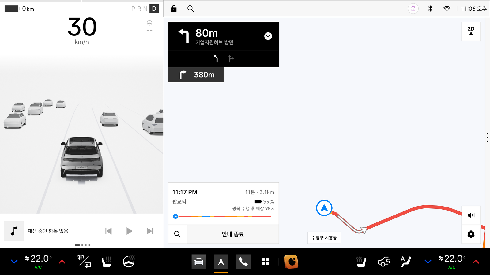<br><b>주행 중</b><br>Drive Well 화면은 없다. 내비만 보이고, 앱은 백그라운드에서 기록만 한다</td>
<td width="50%" valign="top">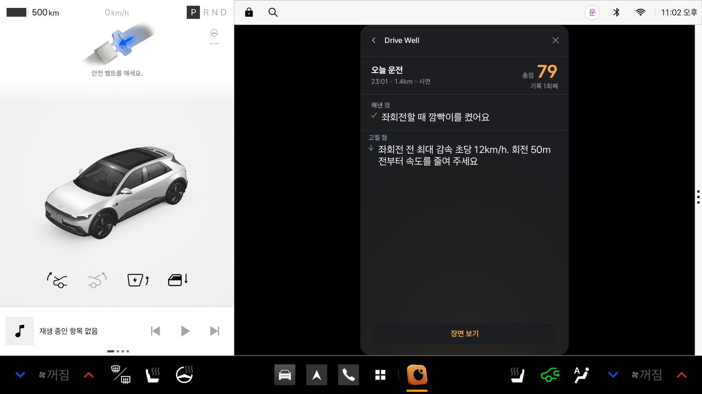<br><b>주차 직후, 오늘의 한 장</b><br>해낸 것 하나와 고칠 점 하나를 문장으로 보여 준다</td>
</tr>
<tr>
<td valign="top"><br><b>장면</b><br>깜빡이를 켠 평균 거리를 30m 기준 자 위에 표시한다</td>
<td valign="top">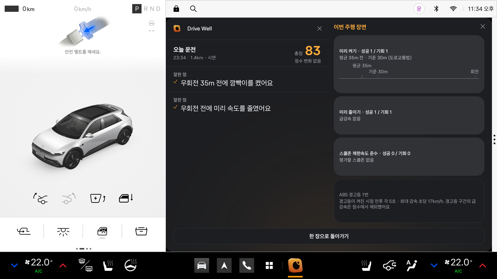<br><b>경고등이 켜진 급감속</b><br>경고등이 켜진 시점 전후 5초의 급감속은 점수에서 뺀다</td>
</tr>
<tr>
<td valign="top">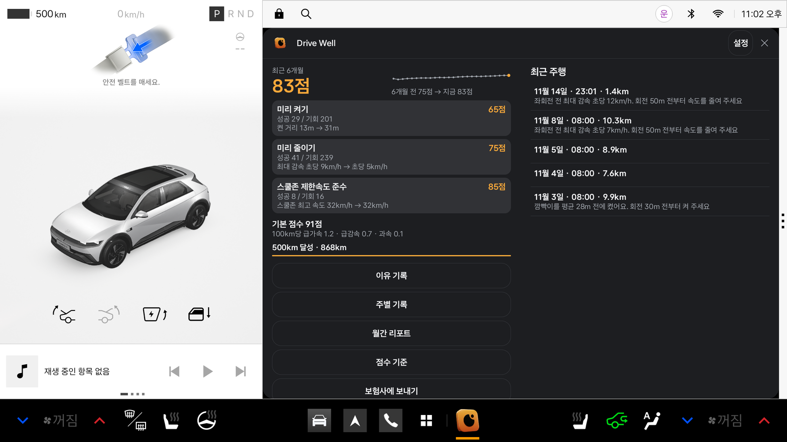<br><b>증명</b><br>최근 6개월 총점, 세 원칙의 추이, 500km 진행도</td>
<td valign="top">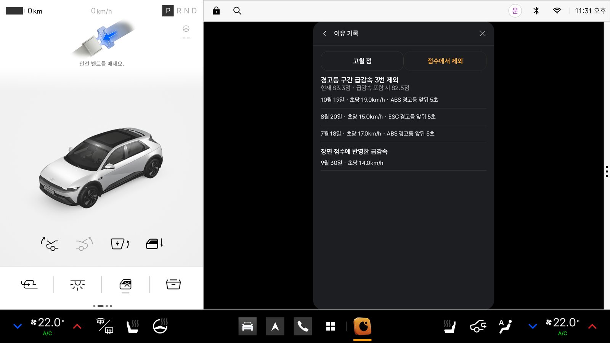<br><b>이유 기록</b><br>점수에서 뺀 급감속이 날짜와 경고등 이름으로 남는다</td>
</tr>
<tr>
<td valign="top">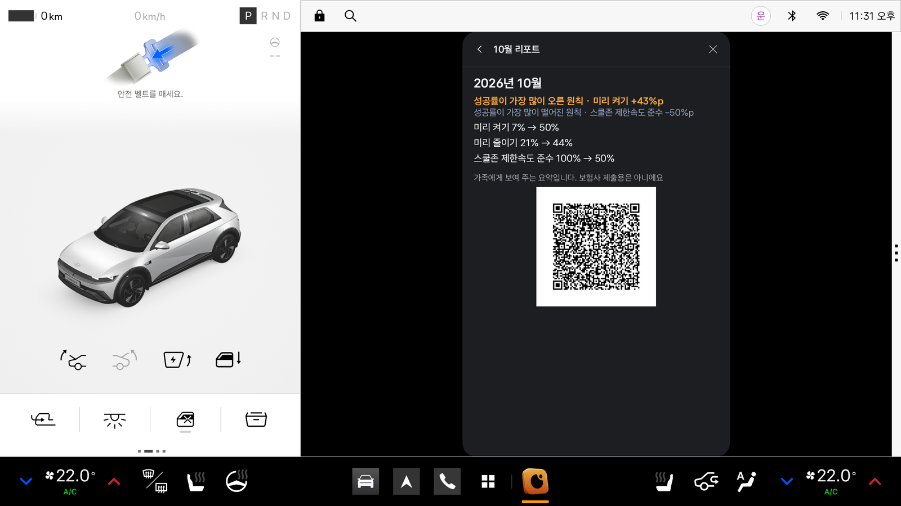<br><b>월간 리포트</b><br>한 달의 변화를 정리하고 QR로 휴대폰에 옮긴다</td>
<td valign="top">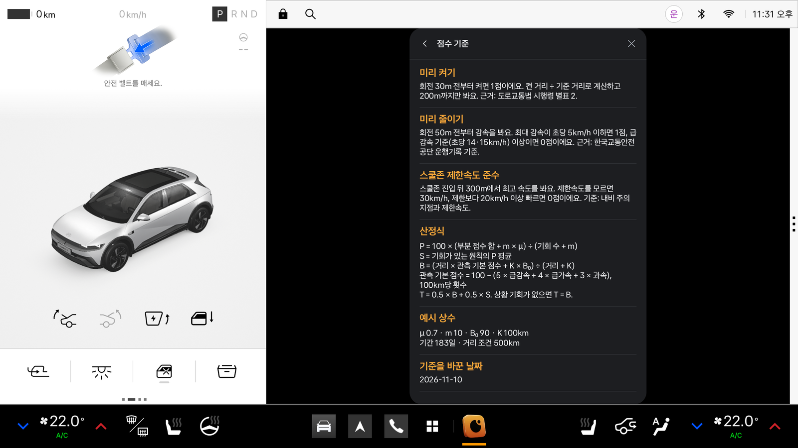<br><b>점수 기준</b><br>산정식, 상수, 기준을 바꾼 날짜를 운전자에게 공개한다</td>
</tr>
</table>

화면은 모두 Pleos Connect Emulator v2.1.0(2560×1440)에서 2026-11-15에 찍었다. 기록은 시연 데이터이고 화면에 "· 시연"으로 표시된다.

## 이용 흐름

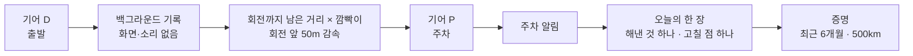

운전자가 주행 중에 하는 일은 없다. 주차한 뒤 알림을 눌러 한 장을 보고, 보험 갱신 전에 앱을 열어 증명을 본다.

## 차에서만 되는 평가

| 신호 | 폰 앱 | Drive Well |
|---|---|---|
| 깜빡이 | 읽지 못한다 | Pleos Vehicle SDK `TurnSignal` |
| 브레이크 페달 | 읽지 못한다 | Pleos Vehicle SDK `Brake` |
| 기어 P (주차한 순간) | 읽지 못한다 | AAOS `GEAR_SELECTION` |
| 차량 경고등 | 읽지 못한다 | Pleos Vehicle SDK `registerTelltales` |
| 회전까지 남은 거리 | 폰 내비 앱 자신만 안다. 깜빡이와 함께 볼 수 없다 | NaviHelper `onTBTInfo` |
| 속도 | GPS로 계산한다 | AAOS `PERF_VEHICLE_SPEED` (클러스터와 같은 값) |

## 데이터와 SDK

데이터 11개 중 6개는 실측 완료, 2개는 일부 실측, 3개는 미실측이다. 실측 완료는 Pleos Connect Emulator v2.1.0에서 값을 받아 본 항목이다.

| 데이터 | SDK·API (권한) | 실측 |
|---|---|---|
| 차량 속도 | AAOS `PERF_VEHICLE_SPEED` (`CAR_SPEED`) | 실측 완료 |
| 기어 | AAOS `GEAR_SELECTION` (`CAR_POWERTRAIN`) | 실측 완료 |
| 깜빡이 | Vehicle State TurnSignal (`CAR_LIGHTS`) | 실측 완료 |
| 브레이크, 주행거리 | Vehicle State Brake, Odometer (`CAR_DRIVE`) | 실측 완료 |
| 핸들 각도 | Vehicle State SteeringWheel | 실측 완료 |
| 주차 알림 | Android 알림 (중요도 HIGH) | 실측 완료 |
| 회전 안내, 안내 상태 | NaviHelper `onTBTInfo`, `NavigationStatus` (`NAVI_ROUTE`) | 일부 실측. 회전 목록은 실측 완료, 주행 중 갱신 주기는 미실측 |
| 차량 경고등 | Vehicle State Safety `registerTelltales` (`CAR_SAFETY`, `PRIVATE_CAR_SAFETY`) | 일부 실측. ESC·ABS는 실측 완료, FCA는 미실측 |
| 주의 지점, 제한속도 | NaviHelper `onCautionPointInfo`, `onCameraAlert`, `onCurrentRoadSpeedLimit` (`NAVI_ROUTE`) | 미실측 |
| 진행 방향 (선택) | FusedLocation heading (`FUSED_LOCATION`) | 미실측 |
| 백그라운드 서비스 | 포그라운드 서비스 (`specialUse`) | 미실측. 부팅 뒤 자동 시작은 확인했다 |

- 속도는 AAOS 차량 속성으로 받는다. Pleos SDK에는 속도 API가 없다.
- 미실측 신호도 받는 코드는 있다. 신호가 오지 않으면 그 항목은 판정하지 않는다.
- 음성 SDK와 Vehicle Control은 쓰지 않는다. 주행 뒤에 평가하는 앱이다.

## 점수와 기록

- 총점은 0~100점이고 최근 6개월·500km를 기준으로 쌓는다.
- 주행 횟수가 적을 때 점수가 튀지 않도록 기회가 적은 원칙은 평균 쪽으로 당긴다.
- 산정식과 상수는 "점수 기준" 화면에 그대로 적혀 있다.
- 기록은 차 안에만 저장한다. 앱에 인터넷 권한이 없다.
- Drive Well 점수로 보험료를 할인받는 것은 2단계 제안이다. 보험사와 협의하기 전이고, 이 저장소에는 전송 기능이 없다.

## APK

[apk/DriveWell_release.apk](apk/DriveWell_release.apk)

- release 설정(서명, 디버그 끔)으로 만든 제출 빌드(`submit`)다.
- 첫 실행 때 6개월 시연 기록(주행 102건)을 한 번 넣는다. 그래서 설치하고 열기만 해도 증명, 한 장, 월간 리포트가 보인다. 이 기록은 화면에 "· 시연"으로 표시된다.
- 시연 진입 명령(`dp.DEMO`)으로 재생과 하이브리드 주행도 돌릴 수 있다(아래 "직접 주행해 보기").

## 실행 방법

1. Pleos Connect 에뮬레이터 v2.1.0을 켠다(아래 "테스트 환경과 필요 설정").
2. APK를 설치한다.

   ```bash
   adb install apk/DriveWell_release.apk
   ```

3. 앱 목록에서 Drive Well을 연다.
4. "무엇을 기록할까요?"에서 [시작하기]를 누른다.
5. 속도 권한과 알림 권한을 허용한다. 속도 권한은 시스템이 위치 접근 창으로 묻는다.
6. 증명 화면이 열린다. 시연 기록만 있으면 최근 6개월 총점은 83점이다.
7. 최근 주행을 누르면 그 주행의 한 장과 장면이 열린다.

### 직접 주행해 보기

Virtual Console로 차를 움직여 새 주행을 만든다. 호스트 PC에 Python 3이 있어야 한다.

1. 로그를 띄운다.

   ```bash
   adb logcat -s DP_DEMO
   ```

2. 조작 도구를 띄운다. `adb forward`, 하트비트, 초기화(속도 0, 깜빡이 Off, 기어 P)를 스스로 한다.

   ```bash
   python tools/dp-console/dp_console.py
   ```

3. `d`(기어 D) → `↑` 세 번(30km/h) → 30초쯤 주행 → `p`(기어 P)를 누른다. 0.2km 이상 달리면 주행이 끝나고 주차 알림이 알림 센터에 뜬다. 앱을 열면 안 본 한 장이 먼저 열린다.

| 키 | 하는 일 |
|---|---|
| `d` / `p` | 기어 D / P |
| `↑` / `↓` | 목표 속도 ±10km/h. 1초에 5km/h씩 바꾼다 |
| `←` / `→` | 깜빡이 LEFT / RIGHT. 한 번 더 누르면 Off |
| `[` / `]` | 핸들 왼쪽 / 오른쪽 300도를 2초. 콘솔에는 반대 부호로 보낸다 |
| `q` | 끝. 하트비트를 닫는다 |

시연 진입 명령은 화면 없이 신호 출처를 바꾼다. 정차 중에 쓴다.

| 명령 | 하는 일 |
|---|---|
| `adb shell am start -a dp.DEMO --es mode replay --es scenario s1` | 시나리오 1(좌회전 15m 점등, 회전 직전 감속)을 재생한다. `s1`~`s5` |
| `adb shell am start -a dp.DEMO --es mode hybrid` | 회전 목록은 내비에서 받고, 회전까지 남은 거리는 라이브 속도로 계산한다. 내비에 경로가 없으면 150초 뒤 판교역으로 경로를 요청한다 |
| `adb shell am start -a dp.DEMO --es mode seed --es scenario m6` | 6개월 시연 기록을 오늘 기준으로 다시 넣는다 |
| `adb shell am start -a dp.DEMO --es mode clear` | 시연 기록을 모두 지운다 |
| `adb shell am start -a dp.DEMO --es mode live` | 재생·하이브리드를 끝내고 실제 차량 신호로 돌아간다 |

## 테스트 환경과 필요 설정

| 항목 | 값 |
|---|---|
| 에뮬레이터 | Pleos Connect Emulator v2.1.0 (Android 14, API 34, user 빌드, `crp_avd_x86_64`) |
| 에뮬레이터 화면 | 2560×1440, density 160 (Connect-S 17인치 규격) |
| 앱 창 | portrait 628×855dp, landscape 1274×855dp에서 확인했다 |
| 호스트 | Windows 10 (x86_64), 외장 GPU. RAM 4GB 이상을 에뮬레이터에 준다 |
| 빌드 도구 | JDK 17, Android SDK 34, Gradle 8.7(wrapper), Android Gradle Plugin 8.5.2, Kotlin 2.0.21 |
| Pleos SDK | Vehicle 2.3.2, NaviHelper 3.0.5 (`https://nexus-playground.pleos.ai/repository/maven-releases/`) |
| 런타임 권한 | `CAR_SPEED`, `POST_NOTIFICATIONS`. 앱이 처음 열릴 때 묻는다. Pleos 권한(`CAR_DRIVE`, `CAR_LIGHTS`, `CAR_SAFETY`, `PRIVATE_CAR_SAFETY`, `NAVI_ROUTE`)은 설치할 때 허용된다 |

- 에뮬레이터 위치는 움직이지 않는다. 그래서 회전까지 남은 거리는 하이브리드 모드가 속도로 계산한다.
- 차량 서비스(`com.android.car`)가 1~2초마다 다시 뜨면 Cold Boot로는 낫지 않는다. Wipe Data 뒤 다시 켠다.
- 주차 알림은 에뮬레이터에서 heads-up 없이 알림 센터에만 보인다.

## 소스에서 빌드

```bash
./gradlew assembleDemo
```

```bash
./gradlew test
```

| 빌드 종류 | 쓰는 곳 | 차이 |
|---|---|---|
| `demo` | 개발과 시연 | `src/demo`(시연 진입 `DemoEntryActivity`, `NAVI_ROUTE_SEARCH`, 시나리오 에셋)가 들어간다. `MIN_KM` 0.2 |
| `release` | 출시 | 시연 진입과 시연 기록이 없다. `MIN_KM` 1.0 |
| `submit` | 제출 APK | `demo` 기능에 release 설정(서명, 디버그 끔). 첫 실행 때 6개월 시연 기록을 넣는다 |

- `debug`는 끈다. 개발 중에도 `demo`를 쓴다.
- `ANDROID_HOME`이 없으면 `local.properties`에 `sdk.dir`을 적는다.
- `./gradlew :app:submitApk`가 `apk/DriveWell_release.apk`를 만든다(이 폴더 기준). 서명 키는 `local.properties`의 `submit.storeFile`, `submit.storePassword`, `submit.keyAlias`, `submit.keyPassword`로 받는다. 키가 없으면 서명 없이 만든다.
- 개발 빌드는 런타임 권한을 함께 주어 설치한다.

  ```bash
  adb install -r -g app/build/outputs/apk/demo/app-demo.apk
  ```

## 구조

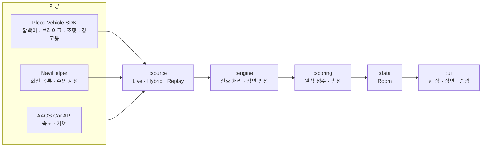

| 모듈 | 하는 일 | 종류 |
|---|---|---|
| `:app` | APK. 매니페스트 권한, 화면 Activity, 시연 진입 | Android |
| `:model` | 신호 타입, 시나리오 파서, 10Hz 재생기 | 순수 Kotlin |
| `:source` | 차량 신호 출처. Live(AAOS 속도·기어, Pleos Vehicle, NaviHelper), Hybrid, Replay | Android |
| `:engine` | 신호 처리, 장면 판정, 한 장 고르기 | 순수 Kotlin |
| `:scoring` | 부분 점수, 원칙 점수, 총점, 주간 요약 | 순수 Kotlin |
| `:data` | Room 저장소, 동의 상태(DataStore), 보관 기간 정리 | Android |
| `:service` | 포그라운드 서비스, 부팅 수신기, 주차 알림 | Android |
| `:ui` | 화면 | Android |

- SDK 콜백, 재생, 판정은 `dp-signal` 스레드 하나에서 돈다. 저장은 입출력 스레드에서 한다.
- 판정 엔진(`:model`, `:engine`, `:scoring`)은 순수 Kotlin이다. 에뮬레이터 없이 JVM 단위 테스트로 검증한다.
- 모듈 하나만 빌드할 때는 `./gradlew :engine:test`, `./gradlew :data:assembleDemo`처럼 부른다.
- 버전은 [libs.versions.toml](gradle/libs.versions.toml) 한 곳에서 고친다.

## 테스트

JVM 단위 테스트는 196개이고 2026-11-15에 모두 통과했다.

| 모듈 | 테스트 수 | 보는 것 |
|---|---|---|
| `:engine` | 121 | 신호 처리, 회전 찾기, 미리 켜기·미리 줄이기 판정, 경고등 앞뒤 급감속, 한 장 고르기 |
| `:scoring` | 25 | 부분 점수, 원칙 점수, 총점, 주간 요약 |
| `:model` | 17 | 시나리오 재생, 신호 값 |
| `:service` | 17 | 주행 상태 전환, 동의 항목에 따른 신호 거르기, 시드 넣기 |
| `:source` | 15 | 실제 신호 변환, 회전까지 남은 거리 계산, 재생 |
| `:ui` | 1 | 월간 리포트 QR에 한글이 그대로 담기는지 |

판정 결과는 기준 구현에서 뽑은 골든 JSON과 비교한다(아래 "시나리오와 골든").

## 시나리오와 골든

재생 시나리오(`app/src/demo/assets/s1.json`~`s5.json`), 6개월 시드(`m6.json`), 골든 JSON(`golden/`)은 판정 규칙의 기준 구현(PRD 저장소의 demo-sim.js, demo-history.js)에서 뽑은 결과다. 손으로 고치지 않는다. 다시 뽑는 스크립트 `tools/golden/export.js`는 PRD 저장소 안에서만 돈다.

| 파일 | 내용 | 쓰는 곳 |
|---|---|---|
| `golden/sN.ticks.json` | 0.1초 격자의 속도, 평활 속도, 가감속, 누적 거리, 남은 거리, 차량 신호 | `:model` 재생기 테스트, `:engine` 신호 처리 테스트 |
| `golden/sN.json` | 장면, 기본 항목, 위험 장면, 점수, 한 장 문구(첫 주행 기준) | `:engine`, `:scoring` 골든 테스트 |
| `golden/scenarios/b1.json`~`b6.json`, `golden/bN.ticks.json`, `golden/bN.json` | 경계 시나리오 6종과 그 결과. 재생 에셋에는 넣지 않는다 | `:model`, `:engine`, `:scoring` 골든 테스트 |
| `app/src/demo/assets/m6.json` | 시드. 주행 102건(장면, 기본 항목, 뺀 급감속)과 주간 요약 26주 | `--es mode seed`, 제출 APK 첫 실행, `:scoring` 주간 요약 테스트 |
| `golden/m6.json` | 시드의 총점, 넣었다면의 총점, 주행마다의 한 장 문구와 고칠 점 | `:scoring`, `:engine` 골든 테스트 |

## 화면 검증

- 빌드와 단위 테스트: `gradlew.bat :app:assembleDemo :app:assembleRelease test`
- 기기 테스트(Android Automotive 에뮬레이터): `gradlew.bat :data:connectedDemoAndroidTest :ui:connectedDemoAndroidTest`
- 시나리오 1을 재생한 뒤 앱을 연다. Room에 저장된 한 장과 거리 자를 확인한다.
- 한 장과 장면을 628×855dp·1274×855dp로 확인했다. 한 장 피드백에 PRD의 36sp를 적용해 26sp 디자인 시안과 글줄이 다르다.

아직 확인하지 않은 것
- Pleos 장비에서 글자 높이 5mm·3mm, 시스템 창 전환, 실제 주차 알림 heads-up
- 실제 내비 주의 지점·제한속도, FusedLocation 진행 방향
- 월간 리포트 QR을 휴대폰 카메라로 읽기
- Pleos 프로필 연결. 저장은 기본 프로필을 쓴다
